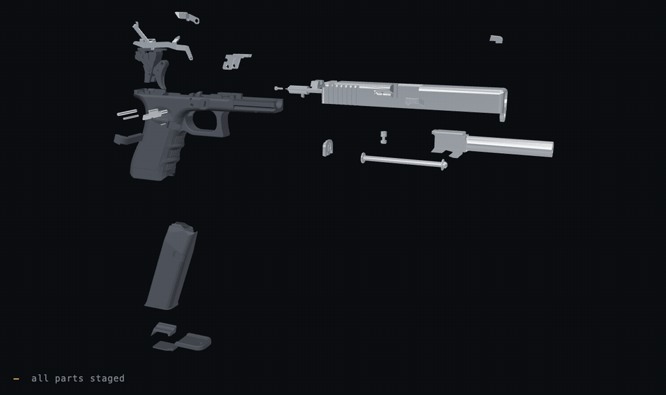

# Glock17-3D-print-model

Glock17 3D print model

## ▶ Watch it go together

**[Open the interactive viewer](https://brycengrose.github.io/Glock17-3D-print-model/)** —
drag to orbit, scrub the timeline, click any part to isolate it, flip the
direction to watch it come apart again.

Every part is the actual STL from this repo, placed where the CAD assembly put
it, moving along a path that was collision-tested against the parts already
fitted. 27 motions in the order a gunsmith does them — frame group first
(housing → trigger bar → connector → housing pin → trigger → trigger safety →
safety pin → trigger pin → mag catch → slide lock → slide catch → locking block
→ locking block pin), then the slide built up on its own (firing pin stack →
firing pin safety → extractor group → cover plate → barrel → recoil spring →
sights), then the slide onto the frame, then the magazine.

Every pin goes in *after* the parts it retains.

The viewer is in [`docs/`](docs/) — plain HTML and JavaScript, no build step, no
network. The motion plan is generated by
[`docs/build.py`](docs/build.py) if you want to regenerate it.
